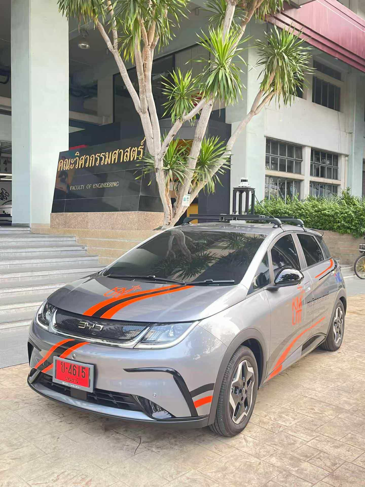
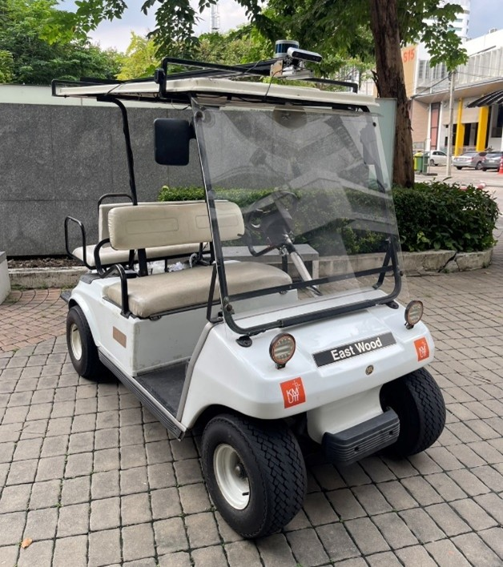
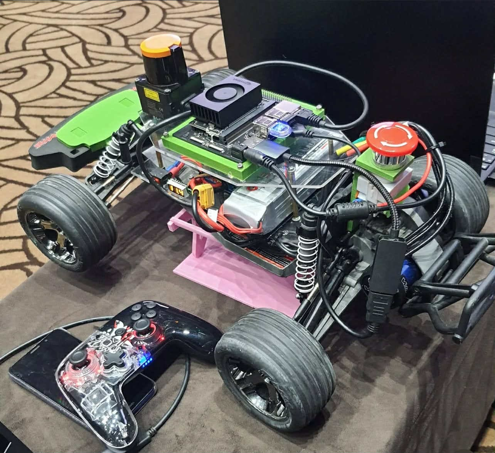
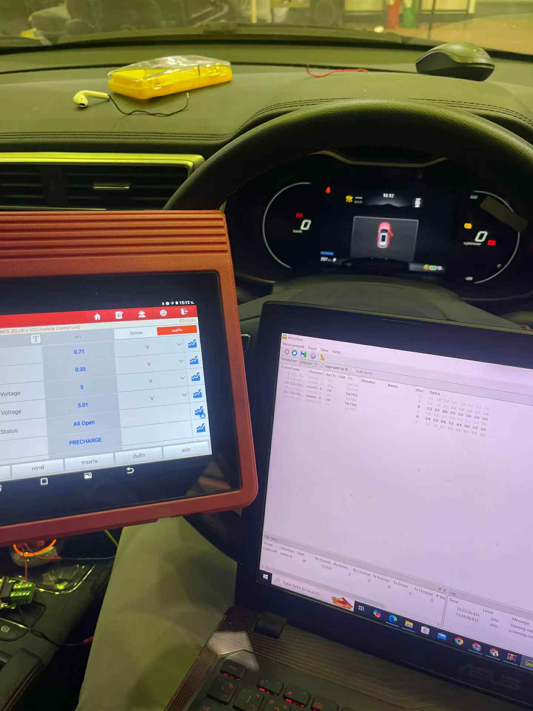
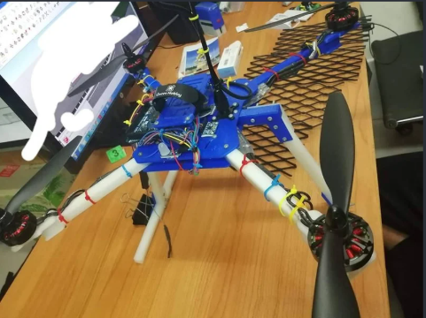

# 👋 Hi, I'm Poomtham Chaiyapoom

**Robotics & Autonomous Vehicles · ROS 2 · Embedded Systems** — KMUTT

🎓 Control Systems and Instrumentation Engineering student at KMUTT  
🤖 Passionate about robotics, embedded systems, and automation  
🚗 Building autonomous vehicle systems with ROS 2, LiDAR, GPS RTK, IMU & stereo camera  
🏁 Participated in F1TENTH Korea 2023 with real-world ROS-based testing  
📬 Contact: poomtham.chaiyapoom@gmail.com

---

## 🚀 What I'm Working On

- 🛺 **Autonomous golf cart** — 3D LiDAR mapping, NDT localization and path following (**Master's research**)
- 🧠 Sensor fusion, real-time control, and robotics frameworks
- 📡 CAN Bus communication with embedded controllers (STM32, motor drivers)
- 🔧 micro-ROS, Arduino-based automation and UAV development

---

## 📑 Projects

| | Project | Highlights |
|---|---|---|
| 🛺 | [Autonomous Golf Cart — Mapping, Localization & ModRide](#-autonomous-golf-cart--3d-mapping--localization) | ROS 2 · LIO-SAM · NDT · RTK · CBF-QP · CAN · STM32 · Web 3D map |
| 🚗 | [ROS 2 Autonomous Vehicle & F1TENTH Korea 2023](#-ros-2-autonomous-vehicle--f1tenth-korea-2023) | YOLOP · ZED 2i · SLAM Toolbox · Pure Pursuit · RC car |
| 🚙 | [Vehicle CAN Bus Data Reader & Motor Control](#-vehicle-can-bus-data-reader--motor-control) | CAN · SDO · ROS 2 |
| 🔌 | [micro-ROS Embedded Nodes](#-micro-ros-embedded-nodes) | micro-ROS · Arduino · SPI |
| 🛰️ | [Xsens MTi IMU/GNSS Driver + NTRIP](#-xsens-mti-imugnss-driver--ntrip) | ROS 2 driver · RTK |
| 🚁 | [Drone Project (Arduino-based UAV)](#-drone-project-arduino-based-uav) | Arduino · Python |
| 📂 | [All repositories](#-all-repositories) | |

---

### 🛺 Autonomous Golf Cart — 3D Mapping & Localization

End-to-end autonomy stack for an electric golf cart on the KMUTT campus, in two stages:

1. **Mapping** — drive the cart once while **LIO-SAM** fuses an **Ouster OS-1-128** LiDAR, IMU,
   **u-blox ZED-F9R RTK GNSS** (via NTRIP) and wheel speed from CAN into a geo-referenced 3D point cloud map
   (~36M points covering most of the campus).
2. **Localization & driving** — **NDT** matches live scans to the map for the cart's pose, then a
   **Pure Pursuit** follower with a **CBF-QP** safety layer drives a planned path through `/cmd_vel`
   → CAN → STM32 throttle/brake board and KEYA steering motor.

Custom RViz panels start each step with one button and show a to-scale cart model on the map.
**ModRide** is the passenger-facing web app: a 3D campus map to pick a destination building and
watch the cart's live position streamed from the localization stack.

| Repo | What's inside |
|---|---|
| 🗺️ [**Mapping**](https://github.com/Pakgard007/Mapping) | LIO-SAM (Ouster 128 + GPS + wheel speed), mapping RViz panel, NTRIP client, CAN low-level, STM32 firmware |
| 📍 [**Localize_get_path**](https://github.com/Pakgard007/Localize_get_path) | NDT localization, cart RViz panel, path follower, CBF-QP controller, campus buildings overlay |
| 💾 [**golfcart-maps**](https://github.com/Pakgard007/golfcart-maps) | Point cloud maps (`.pcd`) in Releases |
| 🐜 [**ModRide**](https://github.com/Pakgard007/ModRide) | Web 3D campus map: pick a building, pickup points, live 3D cart position (MapLibre + three.js) |

<table>
  <tr>
    <td width="50%"></td>
    <td width="50%"></td>
  </tr>
  <tr>
    <td align="center">ModRide — 3D campus map with live cart position</td>
    <td align="center">Low-level control: ROS 2 ↔ CAN ↔ STM32 (speed / brake) + KEYA steering</td>
  </tr>
</table>

---

### 🚗 ROS 2 Autonomous Vehicle & F1TENTH Korea 2023

Designed and implemented an autonomous vehicle system using **ROS 2** on Linux, integrating **LiDAR**, **GPS**, **IMU**, and **ZED stereo camera**.  
Used **YOLOP** for perception, **SLAM Toolbox** for localization, and **Pure Pursuit** for real-time path tracking.  
✅ Successfully tested in the **F1TENTH Korea Championship 2023**.

🔗 [ZED-2i_Lane_Object_Detection_](https://github.com/Pakgard007/ZED-2i_Lane_Object_Detection_) — YOLOP drivable area & lane detection + ZED 2i 3D object detection  
🔗 [INC493_final](https://github.com/Pakgard007/INC493_final) — 1/10 RC car with VESC, Hokuyo LiDAR, joystick manual/auto modes and micro-ROS IMU/encoder

  
  
  

---

### 🚙 Vehicle CAN Bus Data Reader & Motor Control

📥 Read real-time vehicle data such as **speed**, **steering angle**, and **sensor values** via CAN Bus  
⚙️ Displayed via **Serial** and integrated into **ROS 2**  
🎛️ Motor position control over CAN (**SDO**) from a ROS 2 `/cmd_angle` topic, with smooth transitions and feedback monitoring

🔗 [CANBus](https://github.com/Pakgard007/CANBus)

  

---

### 🔌 micro-ROS Embedded Nodes

- 🔗 [micro-ROS-Digipot-Servo-Control-Node](https://github.com/Pakgard007/micro-ROS-Digipot-Servo-Control-Node) — micro-ROS node that listens to `/final_cmd_vel` and drives a digital potentiometer (SPI), a servo and direction outputs
- 🔗 [micro-ROS-and-install_rosHumble](https://github.com/Pakgard007/micro-ROS-and-install_rosHumble) — step-by-step guide to set up micro-ROS + ROS 2 Humble on Ubuntu 22.04

---

### 📡 Xsens MTi IMU/GNSS Driver + NTRIP

ROS 2 Humble driver for **Xsens MTi-680G** (also MTi-8 / 630 / 300) with full IMU + GNSS output
and real-time **RTK** positioning through an NTRIP client.

🔗 [Xsens-MTi-ROS-Driver-and-Ntrip-Client_ROS2_humble](https://github.com/Pakgard007/Xsens-MTi-ROS-Driver-and-Ntrip-Client_ROS2_humble)

---

### 🚁 Drone Project (Arduino-based UAV)

Designed and built drones using **Arduino** as the flight controller.  
Implemented motor control, sensor integration, and communication systems for aerial applications.

🔗 [smartdrone_edu_python](https://github.com/Pakgard007/smartdrone_edu_python) — Python programming course material for smart drones

  

---

### 📂 All Repositories

| Repository | Topic |
|---|---|
| [Mapping](https://github.com/Pakgard007/Mapping) | 🛺 Golf cart — 3D mapping (LIO-SAM) |
| [Localize_get_path](https://github.com/Pakgard007/Localize_get_path) | 🛺 Golf cart — NDT localization & path following |
| [golfcart-maps](https://github.com/Pakgard007/golfcart-maps) | 🛺 Golf cart — point cloud maps |
| [ModRide](https://github.com/Pakgard007/ModRide) | 🛺 Golf cart — web 3D campus map & live cart position |
| [3Dmap_localiz](https://github.com/Pakgard007/3Dmap_localiz) | 🛺 Golf cart — earlier mapping & localization version |
| [Localize](https://github.com/Pakgard007/Localize) | 🛺 Golf cart — earlier localization version |
| [ZED-2i_Lane_Object_Detection_](https://github.com/Pakgard007/ZED-2i_Lane_Object_Detection_) | 🚗 YOLOP + ZED 2i perception |
| [CANBus](https://github.com/Pakgard007/CANBus) | 🚙 CAN Bus motor control |
| [Xsens-MTi-ROS-Driver-and-Ntrip-Client_ROS2_humble](https://github.com/Pakgard007/Xsens-MTi-ROS-Driver-and-Ntrip-Client_ROS2_humble) | 🛰️ IMU/GNSS driver + RTK |
| [micro-ROS-Digipot-Servo-Control-Node](https://github.com/Pakgard007/micro-ROS-Digipot-Servo-Control-Node) | 🔌 micro-ROS control node |
| [micro-ROS-and-install_rosHumble](https://github.com/Pakgard007/micro-ROS-and-install_rosHumble) | 🔌 micro-ROS setup guide |
| [smartdrone_edu_python](https://github.com/Pakgard007/smartdrone_edu_python) | 🚁 Drone Python course |
| [INC493_final](https://github.com/Pakgard007/INC493_final) | 🏎️ RC car (VESC + LiDAR + micro-ROS) — INC493 final project |

---

## 💻 Programming Languages & Tools

### 🧑‍💻 Languages  
-  **C / C++** – Embedded development, ROS 2 nodes  
-  **Python** – ROS 2, data handling  
-  **Shell / Bash** – Linux scripting  
-  **SQL** – Data logging (basic)

### 🧰 Tools & Frameworks  
- 🤖  **ROS 2 (Robot Operating System)** · micro-ROS  
- 🗺️ **LIO-SAM / NDT localization / PCL** · Ouster LiDAR · u-blox RTK GNSS  
- 🌐 **MapLibre GL / three.js** – web 3D maps  
- 🔌  **Arduino IDE / PlatformIO** · **STM32CubeIDE**  
- 💻  **VS Code**  
- 🏗️ **AutoCAD / SketchUp / Lumion**  
-  **Photoshop**,  **Figma**,  **Premiere Pro**  
-  **Linux (Ubuntu)**  
- 🧩 **SocketCAN / MCP2515 + CAN Bus Modules**  
- 🎯 **ZED SDK / YOLOP / SLAM Toolbox / Pure Pursuit / CBF-QP**

---

## 🌐 Socials
- 🎥 TikTok: [@pakgard.pc](https://www.tiktok.com/@pakgard.pc?_t=ZS-8xomy4pfiG9&_r=1)  
- 📧 Email: [poomtham.chaiyapoom@gmail.com](mailto:poomtham.chaiyapoom@gmail.com)

---

## 📊 GitHub Stats

  

---

⚡ *Fun fact:* I once programmed a drone fleet to fly in formation — and yes, blinking LEDs still make me smile 😄
